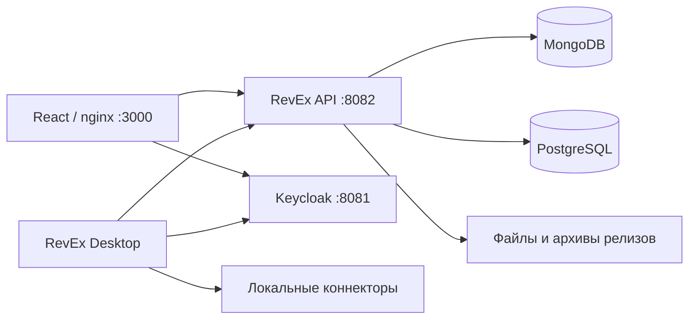

# Архитектура

## Компоненты и потоки

Внутри Docker nginx обращается к `revex-api:8080`, а API загружает OIDC metadata
через `keycloak:8080`. Браузер и Desktop используют публичный issuer
`http://localhost:8081/realms/revex`. Эти адреса выполняют разные задачи.

## Backend: Backend/RevEx

| Проект | Назначение |
| --- | --- |
| `RevEx.Api` | Контроллеры, DI, Swagger, JWT, CORS, проверка совместимости desktop. |
| `RevEx.Application` | Абстракции persistence/storage; общие DTO находятся в Domain. |
| `RevEx.Domain` | Общие сущности, HTTP-контракты и роли из отдельного соседнего репозитория RevEx.Domain. |
| `RevEx.Infrastructure` | MongoDB-репозитории, PostgreSQL-история, файловые хранилища, релизы. |
| `tools/OpenApiExport` | Генерация спецификации из MVC-контроллеров без запуска инфраструктуры. |
| `tests/DesktopReleaseChecks` | Исполняемые проверки хранилища релизов и дополнительного аудита. |

Направление зависимостей: Api → Application/Infrastructure,
Infrastructure → Application/Domain, Application → Domain.
Контроллеры используют `IRepository<T>` и `IUnitOfWork`.

При старте `Program.cs` инициализирует историю, добавляет начальные данные,
подключает Swagger, CORS, authentication, authorization, middleware совместимости
и контроллеры. Поэтому доступность баз нужна ещё до приёма запросов.

## Хранение

- MongoDB: категории, состояния, теги, группы, карточки, версии, метаданные файлов.
- PostgreSQL: история контента, установки desktop, предложения обновлений и скачивания.
- `NetworkFolder`: содержимое файлов в Docker volume `revex-files`.
- `DesktopReleases:Path`: архивы и состояние релизов в `desktop-releases`.
- Альтернативные провайдеры файлов: S3 и Memory; Compose выбирает NetworkFolder.

Пользователи и роли принадлежат Keycloak, а не сущностям каталога.
Подробности связей и ограничений находятся в [ENTITIES.md](ENTITIES.md).

## Frontend

React + TypeScript + Vite; UI использует UIkit и lucide-react.
`src/main.tsx` — вход, `src/App.tsx` — состояние и навигация по pathname,
`src/api.ts` — HTTP-контракты, `src/auth.ts` — Keycloak,
`src/pages` — страницы, `src/components` — общие элементы.
Отдельной библиотеки маршрутизации нет.

Home публична и показывает загрузки desktop при опубликованном релизе.
Admin требует `administrator` и управляет релизами/аудитом; сервер проверяет права независимо от UI.
Отсутствие установщика до публикации релиза — ожидаемое состояние.

## Авторизация

Realm `revex`; публичные OIDC-клиенты `revex-desktop` и `revex-frontend`,
Authorization Code + PKCE S256. Audience API — `revex-api`, роли в claim `roles`.

| Роль | Доступ |
| --- | --- |
| `user` | Чтение каталога. |
| `moderator` | Чтение и изменение контента. |
| `administrator` | Контент, справочники, релизы и аудит. |

Иерархия realm: administrator → moderator → user.
Fallback policy требует вход и роль; отдельные методы релизов/обновлений публичны,
но могут дополнительно требовать ключ установки. См. [API.md](API.md).
ActiveDirectory/IIS предусмотрен кодом как отдельный режим; локальный Compose использует Keycloak.
