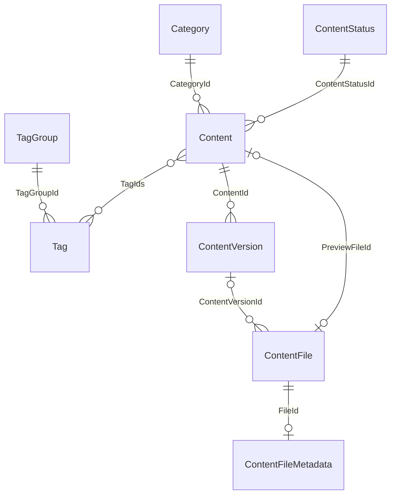

# Сущности RevEx Web

Документ описывает реализованную модель backend, а не ранние планы проекта.
Точные JSON-контракты запросов и ответов приведены в [OpenAPI](openapi.json).
В JSON используется camelCase; ниже имена полей приведены как в C#.

## Хранение и общие поля

Все сущности хранятся в PostgreSQL через EF Core. Содержимое файлов хранится отдельно:
`NetworkFolder` либо S3, в зависимости от конфигурации. Архивы релизов desktop
хранятся в каталоге `DesktopReleases:Path`.

Все восемь сущностей каталога наследуют `AuditableEntity`: `CreatedAt` и
`UpdatedAt` имеют тип `DateTimeOffset`. Их `Id` — целочисленный идентификатор.
Связи обеспечиваются внешними ключами PostgreSQL и таблицей many-to-many для тегов.

## Каталог

| Сущность / таблица PostgreSQL | Поля, кроме Id и общих дат | Назначение и связи |
| --- | --- | --- |
| `Category` / `categories` | `Name: string` | Категория каталога; одна категория содержит много карточек. |
| `ContentStatus` / `contentStatuses` | `Name: string` | Справочник состояний карточки. Не совпадает со строковым статусом версии. |
| `TagGroup` / `tagGroups` | `Name: string` | Группа тегов; содержит много `Tag`. |
| `Tag` / `tags` | `Name: string`, `TagGroupId: int` | Тег принадлежит группе; карточка может иметь несколько тегов. DTO дополнительно возвращает `TagGroupName`. |
| `Content` / `contents` | `Name: string`, `Description: string`, `CategoryId: int`, `ContentStatusId: int`, `PreviewFileId: int?`, `TagIds: int[]` | Карточка контента: категория, состояние, необязательное превью, теги и версии. |
| `ContentVersion` / `contentVersions` | `ContentId: int`, `Name: string`, `Date: DateTimeOffset`, `Platform: enum`, `PublishStatus: enum`, `Status: string`, `Application: string`, `ApplicationVersion: string` | Версия одной карточки. DTO дополнительно возвращает `FileIds`. |
| `ContentFile` / `contentFiles` | `Url: string`, `OriginalFileName: string`, `Extension: string`, `SizeBytes: long`, `Role: string`, `ContentVersionId: int?` | Метаданные файла. Файл версии связан с `ContentVersion`; превью карточки не имеет `ContentVersionId`. `Url` ведёт к API скачивания. |
| `ContentFileMetadata` / `content_file_metadata` | `FileId: int`, `MetadataJson: JSONB` | Произвольные метаданные файла. Собственный `Id` выделяется независимо от `ContentFile.Id`; уникальный индекс `FileId` допускает не более одной записи метаданных для файла. |

Ограничения входных данных:

- Карточка: название до 200 символов, описание до 2000; категория обязательна.
  При создании без состояния используется `draft`; `TagIds: null` при изменении
  сохраняет текущие теги.
- Названия тегов, групп и состояний — до 100 символов.
- Версия: название до 200 символов; `Status` — `draft`, `published` или `archived`;
  `Application` и `ApplicationVersion` — обязательные строки до 100 символов,
  например `revit` / `2026` или `autocad` / `R24.3`.
  `Platform` — обязательное перечисление доменного слоя: `Other = 0`, `Revit = 1`, `AutoCad = 2`.
  `PublishStatus` находится там же и имеет ровно три значения: `Draft = 0` («Черновик»),
  `Ready = 1` («Готов»), `Withdrawn = 2` («Снят»). Новая версия по умолчанию — `Draft`.
  API и PostgreSQL используют числовые значения. Строковый `Status` сохраняется для совместимости
  и синхронизируется сервером с `PublishStatus`: `draft` / `published` / `archived`.
  Для Revit и AutoCad значение `Application` определяется платформой. Импорт RFA всегда
  задаёт `Platform.Revit`, включая чтение через мок-коннектор.
- Файл версии — от 1 байта до 100 MiB: `primary` и `attachment` допускают любые форматы,
  `type-catalog` — `.txt`, `lookup-table` — `.csv`.
  В версии допускается один основной файл `primary`; повторная загрузка возвращает 409.
- `contentFileMetadata.MetadataJson` — JSONB произвольной структуры, связанный
  с файлом через `FileId`. Если метаданных нет, отдельный документ не создаётся.
  В Domain содержимое представлено JSON-текстом `MetadataJson`; EF хранит его как JSONB.
  PostgreSQL-репозиторий присоединяет метаданные по `FileId`, пакетно для списков.
  HTTP DTO по-прежнему возвращает JSON-объект `metadata`.
  При удалении файла запись метаданных удаляется каскадно.
  Схемы Revit, DWG и будущих коннекторов не становятся сущностями общего каталога.
  В актуальных метаданных Revit категория семейства называется `RevitCategory`,
  чтобы отличать её от категории общего каталога.
- Превью — JPEG, PNG, WebP или GIF до 10 MiB.

## История контента

`ContentHistoryEventDto` соответствует таблице PostgreSQL `content_history_events`.

| Поле | Тип | Описание |
| --- | --- | --- |
| `Id` | long | Автоматический идентификатор события. |
| `ContentId` | int | ID карточки каталога. |
| `OccurredAt` | DateTimeOffset | Время события. |
| `Description` | string | Описание изменения; ручной ввод через API — до 2000 символов. |
| `Author` | string | Автор из claims пользователя; хранится как текст. |

История записывается при изменениях контента и файлов; также доступно ручное
добавление события. Пользователи и роли управляются провайдером идентификации,
отдельной доменной сущности пользователя в каталоге нет.

## Релизы desktop

Эти контракты также нужны веб-интерфейсу администратора и странице скачивания.

| Модель | Поля | Назначение |
| --- | --- | --- |
| `DesktopReleaseManifest` | `Version`, `Notes`, `Installers: map<string,string>` | Версия в формате `1.2.3`, заметки и установщики по платформам. |
| `DesktopReleaseRecord` | `Manifest`, `UploadedAt`, `DeletedAt?`, `PublishedAt?`, `IsActive`, `Platforms?` | Состояние загруженного релиза; поддерживает мягкое удаление и восстановление. |
| `DesktopPlatformState` | `PublishedAt?`, `IsActive` | Публикация и поддержка платформы конкретного релиза. |
| `DesktopPlatformTarget` | `Version`, `Installer`, `Notes` | Рекомендованная сборка конкретной платформы. |
| `DesktopReleaseInfo` | `BackendVersion`, `RecommendedDesktopVersion`, `UpdatesPath`, `Installers`, `Notes`, `Targets?` | Публичный ответ для страницы скачивания. |
| `DesktopPackage` | `Version`, `Platform`, `FileName`, `Size`, `Sha256`, `Sha1` | Пакет обновления с размером и контрольными суммами. |
| `DesktopPolicy` | `Decision`, `TargetVersion`, `Notes`, `Package?`, `IsDowngrade` | Решение: `current`, `optional` или `required`; допускает откат версии. |
| `DesktopUpdateResponse` | Поля политики, `OfferId?`, `DownloadPath?` | Ответ проверки обновления с конкретным предложением и адресом пакета. |

Поддерживаются `win-x64`, `osx-x64`, `osx-arm64`. Активация и загрузка сборок
управляются по платформам. Снимок политики в предложении фиксирует пакет:
последующая активация другой версии не меняет выданное предложение.
`/api/desktop-release` возвращает совместимый ответ прежнего протокола;
`/api/desktop-installers` — актуальную информацию для веб-страницы.

## Установки и аудит обновлений

| Модель / таблица PostgreSQL | Поля | Назначение |
| --- | --- | --- |
| `DesktopInstallationInfo` / `desktop_installations` | `InstallationId: Guid`, `Platform`, `Version`, `LastSeenAt`, `UserId?`, `UserName?` | Последнее состояние установки. В таблице дополнительно хранится `key_hash`; API его не возвращает. |
| `DesktopUpdateOffer` / `desktop_update_offers` | `Id: Guid`, `InstallationId`, `FromVersion`, `Policy`, `OfferedAt`, `ConfirmedAt?`, `UserId?`, `UserName?`, `Failure?` | Предложение установки с политикой в JSONB и результатом выполнения. |
| `DesktopDownloadInfo` / `desktop_downloads` | `Id: Guid`, `OfferId?`, `InstallationId?`, `Version`, `FileName`, `StartedAt`, `FinishedAt?`, `Status`, `UserId?`, `UserName?` | Попытка скачивания, включая анонимное скачивание установщика. |
| `DesktopUpdateHistory` | `Installations`, `Updates`, `Downloads` | Агрегированный ответ аудитa для администратора. |

Статусы скачивания: `started`, `transferred`, `partial`, `cancelled`, `rejected`,
`failed`. Передача файла не равна подтверждению установки.
`DesktopInstallationRequest` содержит ID установки, ключ из 64 шестнадцатеричных
символов, версию, платформу и необязательный `CompletedOfferId`.
Ключ установки передаётся также в `X-RevEx-Installation-Key` при скачивании
предложенного пакета и регистрации ошибки; это отдельный механизм от bearer-токена.
